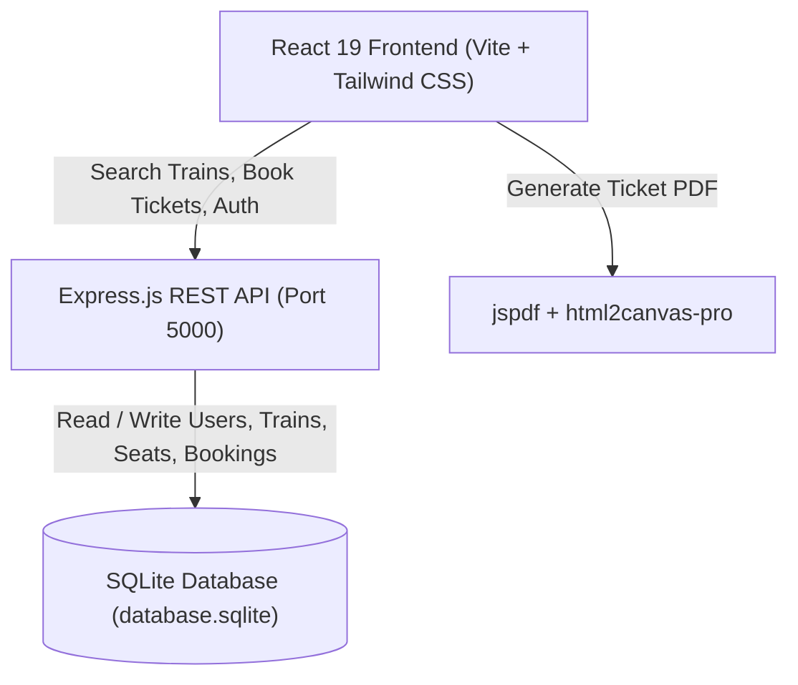

# 🚆 RailConnect — Full-Stack Railway Management & Ticket Booking System

[](https://react.dev/)
[](https://vitejs.dev/)
[](https://tailwindcss.com/)
[](https://nodejs.org/)
[](https://www.sqlite.org/)
[](LICENSE)

> A modern, end-to-end Railway Management and Ticket Reservation web application. Built with high-performance React 19, Tailwind CSS, an Express.js REST API, and SQLite database storage. Featuring real-time train tracking, dynamic seat availability, an authentic IRCTC-style ticket generator with instant PDF download, and a dedicated admin portal.

---

## 🌟 Key Features

### 🔍 1. Smart Train Search & Quota Discovery
- **Route Filtering**: Search scheduled trains by departure station, destination station, and journey date.
- **Multi-Class Availability**: View real-time seat counts and ticket pricing across:
  - **SL** (Sleeper Class)
  - **3A** (AC 3 Tier)
  - **2A** (AC 2 Tier)
  - **1A** (AC First Class)
- **Automatic Day Validation**: Automatically matches train operational schedules with the chosen travel date.

### 📡 2. Real-Time Live Train Tracker
- **Interactive Journey Timeline**: Visualizes departure, intermediate stops, and arrival stations in real time.
- **Dynamic Status & Delays**: Real-time status indicators (On Time, Delayed, Approaching Next Stop) with estimated arrival and departure timestamps.
- **Route Inspection**: Accessible directly from Navbar, Booking cards, Profile, and Ticket Slips.

### 💳 3. Smooth Booking & Payment Workflow
- **Multi-Passenger Booking**: Add multiple passenger names, ages, and berth preferences (Lower, Middle, Upper, Side Lower, Side Upper).
- **Itemized Fare Breakdown**:
  - Base ticket fare
  - IRCTC Service / Convenience fee
  - 5% Government GST tax
- **Payment Gateway Simulation**: Built-in payment gateway flow (Razorpay test integration / card / UPI / netbanking) that verifies transaction success and auto-allocates confirmed PNRs.

### 🎫 4. IRCTC-Style e-Ticket & One-Click PDF Download
- **Authentic Layout**: Modeled after standard Indian Railways / IRCTC electronic reservation slips (ERS) with official watermarks, security notice, passenger coach/berth details, and scan code.
- **Direct PDF Export**: High-resolution client-side PDF generation using `html2canvas-pro` and `jspdf` with crisp formatting and zero server dependency.

### 👤 5. User Account & Journey Dashboard
- **My Bookings**: Categorized lists for all journeys, upcoming trips, and completed travel with color-coded status badges (`CONFIRMED`, `COMPLETED`).
- **Profile Management**: View and update full name, email address, and personal settings directly with SQLite synchronization.
- **Trip Actions**: Track live train status or cancel existing reservations directly from the booking card.

### 🛡️ 6. Admin Management Console
- **Schedule Management**: Create and schedule new trains with custom departure/arrival timings, operating days, and class-specific fares.
- **Quota Updates**: Modify seat availability dynamically across dates.
- **Train Removal**: Delete routes and purge associated seat records.
- **Passenger Registry**: View all registered users across the platform.

### 🌓 7. Premium UI / UX & Dark Mode
- **Dual-Theme Support**: Instant toggle between sleek light mode and deep dark mode.
- **Moving Train Animation**: Atmospheric animated train footer with scenic parallax effects.
- **Fully Responsive**: Optimized for ultra-wide screens, laptops, tablets, and smartphones.

---

## 🏗️ System Architecture



---

## 🛠️ Tech Stack

| Domain | Technologies & Libraries |
|---|---|
| **Frontend UI** | React 19, React Router DOM v7, Tailwind CSS 4, Lucide/Heroicons SVG |
| **PDF Generation** | `jspdf`, `html2canvas-pro`, `html2canvas` |
| **Backend API** | Node.js, Express.js 5, CORS |
| **Database** | SQLite3 (`sqlite3` package with auto-initialization & route seeder) |
| **Build & Tooling** | Vite 7, ESLint 9 |

---

## 📂 Project Directory Structure

```plaintext
Railway_management_system/
├── backend/
│   ├── database.sqlite          # SQLite database (auto-generated on first run)
│   ├── package.json             # Backend dependencies & scripts
│   ├── server.js                # Express REST API, SQLite schemas & seeders
│   └── .gitignore
├── public/                      # Static web assets
├── src/
│   ├── assets/                  # Logos, train artwork & theme images
│   ├── components/
│   │   ├── AdminDashboard.jsx   # Admin panel (train schedules, seat management)
│   │   ├── Faqs.jsx             # Frequently Asked Questions accordion
│   │   ├── Hero.jsx             # Main train search widget & banner
│   │   ├── Home.jsx             # Landing view wrapper
│   │   ├── LiveTrainTracker.jsx # Real-time train status & station timeline modal
│   │   ├── MovingTrainFooter.jsx# Animated scenic train footer
│   │   ├── Navbar.jsx           # Top navigation, theme switcher & user menu
│   │   └── SearchResults.jsx    # Train listings, class pricing & quota cards
│   ├── pages/
│   │   ├── About.jsx            # About RailConnect page
│   │   ├── Admin.jsx            # Admin login authentication
│   │   ├── Booking.jsx          # Passenger form & payment checkout
│   │   ├── Dashboard.jsx        # User portal dashboard
│   │   ├── Login.jsx            # User sign-in
│   │   ├── MyBookings.jsx       # Booking history, status & actions
│   │   ├── Profile.jsx          # Profile details & SQLite sync
│   │   ├── Register.jsx         # User registration
│   │   └── TicketSlip.jsx       # IRCTC e-Ticket view & PDF download
│   ├── App.jsx                  # Main routing & layout structure
│   ├── index.css                # Global styles & Tailwind CSS imports
│   └── main.jsx                 # React root DOM entry
├── index.html                   # HTML5 template
├── package.json                 # Frontend dependencies & root scripts
├── vite.config.js               # Vite bundler configuration
└── README.md                    # Project documentation
```

---

## 🚀 Quick Start Guide

### Prerequisites
- [Node.js](https://nodejs.org/) (version 18+ recommended)
- `npm` (comes bundled with Node.js)

---

### Step 1: Clone the Repository

```bash
git clone https://github.com/Bikramsingh008/Railway-Management-System.git
cd Railway-Management-System
```

---

### Step 2: Install Dependencies

Install root (frontend) dependencies:
```bash
npm install
```

Install backend dependencies:
```bash
cd backend
npm install
cd ..
```

---

### Step 3: Run the Backend & Frontend

#### Option A: Running from Root (Recommended)

1. **Start the Backend Server (Port 5000):**
   ```bash
   npm run server
   ```
   *(The server will automatically create `database.sqlite` and seed default train routes like RC101–RC110).*

2. **In a new terminal window, start the Frontend (Port 5173):**
   ```bash
   npm run dev
   ```

#### Option B: Running Individually

**Terminal 1 (Backend):**
```bash
cd backend
npm start
```

**Terminal 2 (Frontend):**
```bash
npm run dev
```

Open your browser and navigate to: **`http://localhost:5173`**

---

## 🔑 Default Credentials

### Admin Login
- **URL**: Navigate to `/admin` from the navigation menu or address bar.
- **Username**: `admin`
- **Password**: `admin123`

### User Login
- Register any new account through the `/register` page or test with any credentials you create. User credentials and bookings are securely stored in the SQLite database.

---

## 📡 API Endpoints Reference

The backend exposes a clean REST API on `http://localhost:5000`:

| Method | Endpoint | Description | Request Body / Parameters |
|---|---|---|---|
| `POST` | `/api/register` | Register a new user | `{ username, password, email, first_name, last_name }` |
| `POST` | `/api/login` | Authenticate existing user | `{ username, password }` |
| `PUT` | `/api/user/:id` | Update user profile | `{ first_name, last_name, email }` |
| `GET` | `/api/trains` | Fetch trains (filter by date & route) | `?source=Delhi&destination=Mumbai&date=YYYY-MM-DD` |
| `POST` | `/api/trains` | Add or update train schedule & seats (Admin) | Train object with timings, quota, prices |
| `DELETE`| `/api/trains/:id` | Delete a train and its seat records (Admin) | URL parameter `:id` |
| `POST` | `/api/book` | Confirm booking, decrement seats, create PNR | Booking details & passenger array |
| `GET` | `/api/bookings/:userId` | Get all bookings for a user | URL parameter `:userId` |
| `GET` | `/api/booking/:bookingId` | Get individual booking slip data | URL parameter `:bookingId` |
| `GET` | `/api/admin/users` | List all registered users (Admin) | *None* |

---

## 🚆 Pre-Seeded Train Routes

On its initial run, the SQLite database automatically populates 10 standard routes with dynamic seat capacities for the next 8 days:

- **RC101** — *RailConnect Express* (Delhi ⇄ Mumbai)
- **RC102** — *Himalayan Swift* (Delhi ⇄ Dehradun)
- **RC103** — *Coastal Queen* (Mumbai ⇄ Goa)
- **RC104** — *Southern Star* (Chennai ⇄ Bangalore)
- **RC105** — *Gateway Superfast* (Ahmedabad ⇄ Mumbai)
- **RC106** — *Eastern Arrow* (Kolkata ⇄ Patna)
- **RC107** — *Desert Wind* (Jaipur ⇄ Delhi)
- **RC108** — *Deccan Pride* (Pune ⇄ Hyderabad)
- **RC109** — *Haldwani Janshatabdi* (Haldwani ⇄ Dehradun)
- **RC110** — *Nilgiri Mountain Express* (Coimbatore ⇄ Ooty)

---

## 📦 Building for Production

To create an optimized production build of the frontend:

```bash
npm run build
```

Preview the production build locally:

```bash
npm run preview
```

---

## 🤝 Contributing

Contributions, issues, and feature requests are welcome!
1. Fork the Project
2. Create your Feature Branch (`git checkout -b feature/AmazingFeature`)
3. Commit your Changes (`git commit -m "feat: Add some AmazingFeature"`)
4. Push to the Branch (`git push origin feature/AmazingFeature`)
5. Open a Pull Request

---

## 📄 License

Distributed under the **MIT License**. See `LICENSE` for more information.

---

Made with ❤️ by [Bikram Singh](https://github.com/Bikramsingh008)
